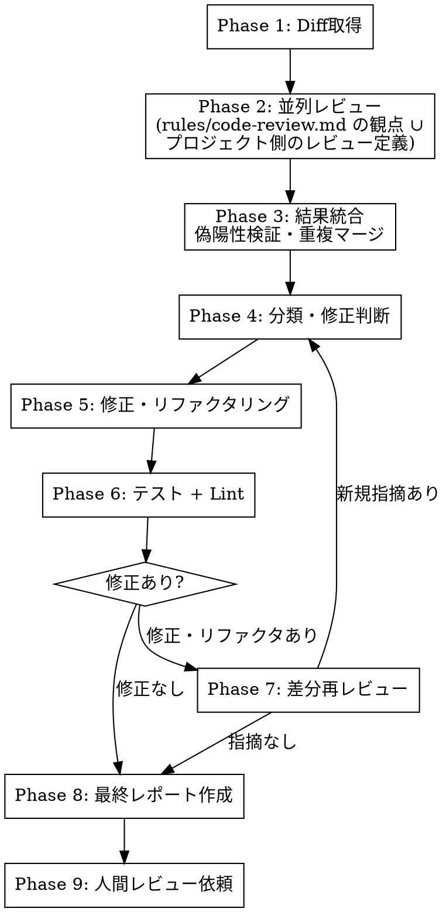

多角的サブエージェントレビュー → 自動修正 → 再レビューを繰り返し、完璧な状態で人間にレビューを依頼する。

## 対象判定

- `$ARGUMENTS` が指定されている場合: PR番号として扱う（`gh pr diff $ARGUMENTS`）
- `$ARGUMENTS` が未指定の場合: current branch vs ベースブランチ の diff（`git diff <base>...HEAD`）
- diff が 0 行の場合: uncommitted changes を含める（`git diff <base> -- app/ src/ lib/ spec/ test/`）
- ベースブランチの決定: `develop` があれば `develop`、なければ `main`

## ワークフロー概要



## Phase 1: Diff取得

1. 対象判定に基づいてdiffを取得し `/tmp/review_diff.patch` に保存
2. PR番号がある場合: `gh pr view` でPR情報を取得、JiraチケットURLがあれば `mcp__atlassian__getJiraIssue` でタスク背景を把握
3. `--name-only` で変更ファイル一覧を取得

## Phase 2: 並列レビュー

### 観点の決定

レビュー観点は `~/.claude/rules/code-review.md` に定義されている。まずこのファイルを Read する。

次に、プロジェクト側にレビュー観点の定義があるかを探す（`.claude/skills/` 配下のレビュー系スキル、`.claude/commands/code-review*.md`、`.github/prompts/review_*.md` 等）。コマンド名は決め打ちにせず、レビュー観点を定義しているものを実体で探す。

起動する観点は**両者の和集合**とする。同じ観点が両方にある場合はプロジェクト側の定義を使う（スタック固有のチェック項目を持つぶん具体的なため）。プロジェクト側にしか無い観点（ドメイン固有のレビュー等）も起動する。`~/.claude/rules/code-review.md` にしか無い観点（コメント・構造など）は、そのファイルの記述を基準にして起動する。

観点数ぶんのサブエージェントを1体ずつ、全て並列で起動する。

### エージェントへの指示に含めるもの

プロジェクト側にテンプレートがある場合はそれに従う。無い場合は以下を渡す。

- 対象 diff（Phase 1 で保存したファイル）と変更ファイル一覧
- 観点名と、その観点の基準となるファイルのパス（エージェント自身に Read させる）
- severity の区分（critical / high / medium / low）と findings の出力形式（file / line / description / suggestion）
- その観点で問題が無ければ findings を空配列で返すこと

起動方法:
- 外部モデル（Codex CLI / Gemini CLI）: `command -v` で存在確認後、Bash tool, `run_in_background: true`
- Claude サブエージェント: Agent tool, `subagent_type: "general-purpose"`, `run_in_background: true`
- **全て並列で起動する**

### コンテキスト管理

- エージェントが完了するまでの間、他の作業（Phase 3 の準備等）を進めてよい
- **セッション切れへの備え**: エージェントのIDを記録し、`TaskOutput` で結果を回収する。セッションが切れた場合は、出力ファイル (`/private/tmp/claude-501/.../tasks/<id>.output`) を直接 Read する

## Phase 3: 結果統合

1. 全エージェント結果を収集（タイムアウトや実行失敗はスキップしレポートに記載）
2. severity を統一: Codex `[P1]/[P2]/[P3]` → `CRITICAL/HIGH/MEDIUM`
3. **偽陽性チェック**: 指摘が事実か自分で検証する
   - コードを直接読んで確認
   - DB定義はスキーマファイル（`db/structure.sql` や `db/schema.rb` 等）を Grep で確認
   - 必要ならプロジェクトの実行環境で実測
4. **重複マージ**: 複数モデルが同じ問題を検出した場合、1つにまとめて検出数を記載（検出数が多いほど信頼度が高い）
5. severity 順にソート

## Phase 4: 分類・修正判断

各指摘を以下に分類する:

| 分類 | 基準 | アクション |
|------|------|------------|
| **修正する** | 今回の開発スコープ内で修正・改善可能 | Phase 5 で修正 |
| **スコープ外** | 今回の開発範囲に含まれない既存コードの問題 | 修正しない。レポートに記載 |
| **別チケット** | マイグレーション追加など別作業が必要 | 修正しない。レポートに推奨事項として記載 |
| **偽陽性** | 検証の結果、問題ではなかった | レポートの偽陽性セクションに記載 |

### スコープの判断基準
- **スコープ内**: 自分が今回追加・変更したコード、およびそれに直接関わるコード
- **スコープ外**: 今回の変更と無関係の既存コード
- リファクタリングも積極的に行う。severity に関係なく、スコープ内のコードは最善の状態にする

## Phase 5: 修正・リファクタリング実施

1. 「修正する」に分類された問題を全て修正
2. エージェントの指摘に加え、スコープ内のコードについて自分でもリファクタリングの余地を検討する:
   - メソッド分割・抽出（長すぎるメソッド、責務の混在）
   - 命名改善（意図が伝わらない変数名・メソッド名）
   - 不要な複雑さの除去
   - テストの充実（不足している境界値・異常系テスト）
   - コメントの過不足（`~/.claude/rules/code-comments.md` の規則で判定）
   - アドホックな対処になっていないか（構造に手を入れればシンプルに解けないか）
3. 修正ごとに根拠を記録（後のレポートで使用）
4. **目標**: 「これより良い状態は存在しない」と断言できる品質にする

## Phase 6: テスト + Lint

プロジェクトのテスト・Lint実行方法に従って実行する（Docker内実行が必要なプロジェクトでは適切なprefix を付与）。

- 全テスト合格 かつ Lint 0 offenses であること
- 失敗した場合は修正してリトライ

## Phase 7: 再レビュー判定

### 再レビューが必要な場合
- Phase 5 で何らかの修正・リファクタリングを行った場合

### 再レビューの方法
- **全エージェント再起動は不要**
- Agent tool で1つのサブエージェントを起動（`subagent_type: "general-purpose"`）
- プロンプトに以下を含める:
  - 修正前後の差分（`git diff` の結果）
  - 変更ファイル一覧
  - 「修正が正しいか」「新たな問題を導入していないか」「さらに改善できる余地がないか」の3点を検証するよう指示
- 新規指摘があれば Phase 4 に戻る

### 再レビューが不要な場合
- Phase 5 で修正なし → Phase 8 へ

## Phase 8: 最終レポート作成

`.claude/tasks/` に保存:
- PR番号がある場合: `thorough-review-PR-<PR番号>.md`
- 未指定の場合: `thorough-review-<ブランチ名>.md`

レポート形式:
```
# レビュー結果: <ブランチ名 or PR>

## モデル別サマリ
| **モデル** | **Critical** | **High** | **Medium** |
|-----------|-------------|---------|-----------|
（実行失敗のモデルは「実行失敗」と記載）

## 修正済みの問題
| # | 内容 | 検出元 |
|---|------|--------|
（修正ごとに: 何を・なぜ・どう修正したか）

## 未修正の指摘
### スコープ外（詳細、検出元モデル明記）
### 別チケット推奨（詳細、検出元モデル明記）

<details><summary>Medium findings（未修正）</summary>

（簡潔、検出元モデル明記）

</details>

## 偽陽性（検証済み）
| 指摘 | 検出元 | 否定根拠 |

## 検証結果
- テスト: X件合格、Y failures
- Lint: X offenses
- テナント分離漏れ: あり/なし

## 総合判定
LGTM / LGTM（条件付き） / 要修正
```

## Phase 9: 人間レビュー依頼

以下の形式でユーザーに報告する:

```
## 最終レビュー結果 — 人間レビューをお願いします

レポート: <ファイルパス>

### 修正済み (N件)
| 修正 | 信頼度 |

### 残存指摘（別チケット推奨）
| 優先度 | 内容 | 検出数 |

### 検証結果
- テスト / Lint / テナント分離漏れ の結果

### 偽陽性
- 検出されたが問題ではなかった指摘
```

## 重要な原則

- **開発スコープ内は徹底的に**: 自分が開発した部分とそれに関わる部分は、リファクタリングも含めて最善の状態にする
- **開発スコープ外は触らない**: 今回の変更と無関係の既存コードは修正しない
- **偽陽性は必ず検証**: エージェントの指摘を鵜呑みにしない。特に型不一致やインデックスの有無はDB定義で確認する
- **複数モデル検出 = 高信頼度**: 3つ以上のモデルが同じ問題を検出した場合、優先的に対応する
- **収束条件**: 「これより良い状態は存在しない」と断言できること。テスト全合格、Lint 0 offenses は最低条件
